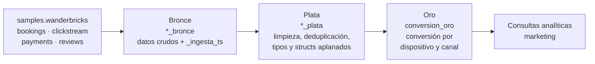
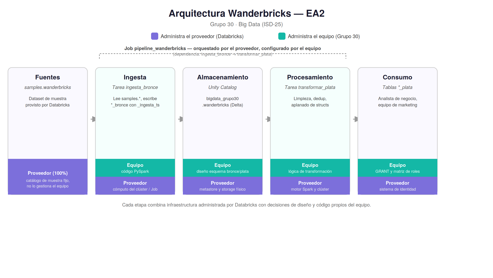
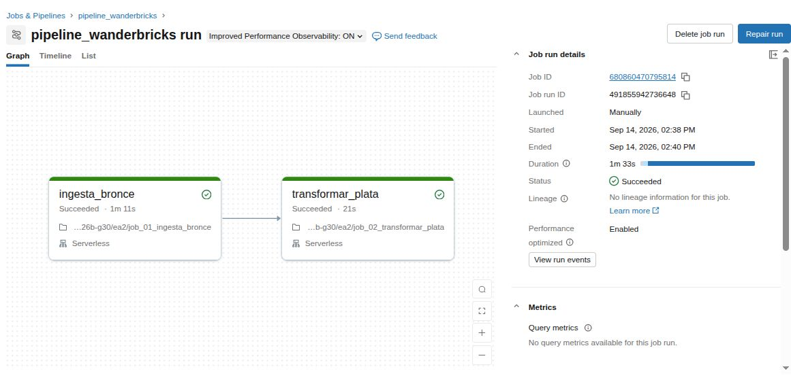
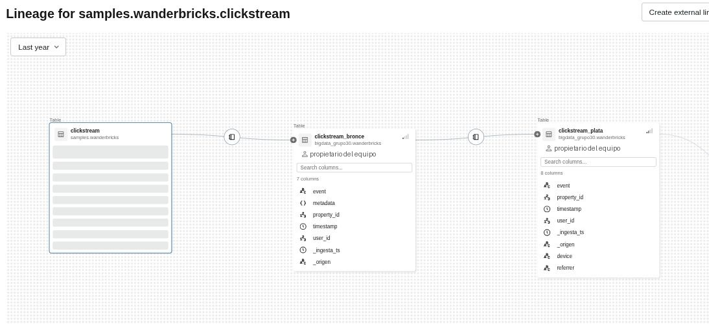

# Wanderbricks · Lakehouse en Databricks

Lakehouse con **arquitectura medallón (bronce → plata → oro)** sobre Databricks, PySpark y Delta Lake, para un marketplace de alquiler vacacional. Responde una pregunta de marketing: **¿qué combinaciones de dispositivo y canal de origen terminan en reservas confirmadas y pagadas?**

Proyecto académico del curso Big Data (IU Digital de Antioquia, 2026), desarrollado en equipo por el Grupo 30.

## 🏗️ Arquitectura





| Capa | Qué contiene | Decisiones |
|---|---|---|
| **Bronce** | Copia de 4 tablas del catálogo de muestra: bookings (72.247 filas), clickstream (100.000), reviews (99.793) y payments (49.638) | Datos sin transformar más la marca de ingesta `_ingesta_ts`, para poder reprocesar sin volver a la fuente |
| **Plata** | Tablas limpias y tipadas | Sin duplicados ni montos nulos, reseñas con borrado lógico excluidas y el struct `metadata` de clickstream aplanado en `device` y `referrer` |
| **Oro** | `conversion_oro` | Tabla agregada y documentada con `COMMENT` en tabla y columnas, lista para el equipo de marketing |

## 💡 Decisiones técnicas

- **Delta Lake en todas las capas**, por cuatro garantías que se demuestran en el EA1:
  - **ACID:** cada escritura se confirma completa o no se aplica.
  - **Historial de transacciones** con `DESCRIBE HISTORY`.
  - **Time travel**, capturando la versión de forma dinámica, porque fijar `VERSION AS OF` falló cuando la retención de 7 días eliminó la versión.
  - **Evolución de esquema** con `mergeSchema`.
- **PySpark y SQL sobre el mismo modelo:** las consultas de negocio se resuelven en ambos lenguajes.
- **Gobierno con Unity Catalog:** catálogo y esquema propios, una matriz de roles y `GRANT` de distinto nivel (`USE SCHEMA` general frente a `SELECT` sobre una sola tabla), verificados con `SHOW GRANTS`.
- **Automatización con un Job de 2 tareas encadenadas** (`ingesta_bronce` → `transformar_plata`) en cómputo serverless, con el linaje de `clickstream` verificado en Unity Catalog.





## ⚡ Optimización de Spark (EA3)

Se midió un cruce entre `clickstream_plata` y `bookings_plata`:

- **Caso base:** `SortMergeJoin`, con dos `Exchange hashpartitioning` que mueven ambas tablas por la red, ordenamiento de las dos y salida del motor vectorizado Photon.
- **Optimizado:** `hint("broadcast")` sobre `bookings_plata`. El plan cambió como se esperaba: desapareció el shuffle de la tabla grande y el cruce se resolvió con `BroadcastHashJoin`, nativo de Photon.
- **Resultado honesto:** la línea base tuvo una mediana de 1,10 s (descartando la ejecución de calentamiento). Con el broadcast, el tiempo **no mejoró de forma consistente**: −6,3 % en una corrida y +17,2 % en otra. A este volumen el shuffle que se evita es pequeño. El notebook analiza ese límite y cuándo el broadcast empeora el resultado.

## 📂 Estructura

```
ea1/   EA1 · Base de datos analítica: capas bronce y plata, garantías de Delta y consultas
ea2/   EA2 · Infraestructura y gobierno: arquitectura, permisos, linaje y Job
       job_01_ingesta_bronce.ipynb · job_02_transformar_plata.ipynb
ea3/   EA3 · Procesamiento distribuido: capa oro, plan de ejecución y optimización
```

Los notebooks se guardan sin outputs. Al ejecutarlos en Databricks se regeneran.

## ▶️ Cómo reproducirlo

1. Un workspace de Databricks con Unity Catalog. El catálogo de muestra `samples.wanderbricks` viene incluido, así que **no hay que descargar datos**.
2. Importar el repositorio como Git folder (*Workspace → Create → Git folder*).
3. Ejecutar en orden `ea1/EA1_plantilla.ipynb` → `ea2/EA2_plantilla.ipynb` → `ea3/EA3_plantilla.ipynb`. Las tablas se crean en el catálogo `bigdata_grupo30`, esquema `wanderbricks`. Si quieres usar otro catálogo, cambia `CATALOGO` en la celda de configuración de cada notebook.
4. Opcional: crear un Job con `job_01_ingesta_bronce` y `job_02_transformar_plata`, el segundo dependiente del primero.

## 👥 Equipo y mi rol

| Integrante | Aportes principales |
|---|---|
| **Hanna Salinas** | Contexto y descripción de los datos, capa bronce, garantías de Delta Lake (ACID, historial, time travel, evolución de esquema), linaje y automatización con Jobs, línea base y plan de ejecución de la optimización, y consolidación de los notebooks |
| Andrés Felipe Grisales Vahos | Consultas analíticas en SQL y PySpark, arquitectura y comparación IaaS/PaaS/SaaS, aplicación y análisis del broadcast join |
| Arley Steven Franco Galeano | Capa plata y datos semiestructurados, gobierno y permisos (matriz de roles, GRANT), capa oro y recorrido del dato |

## 📄 Licencia

Código bajo licencia [MIT](LICENSE). Los datos pertenecen al catálogo de muestra de Databricks y no se incluyen en este repositorio.
